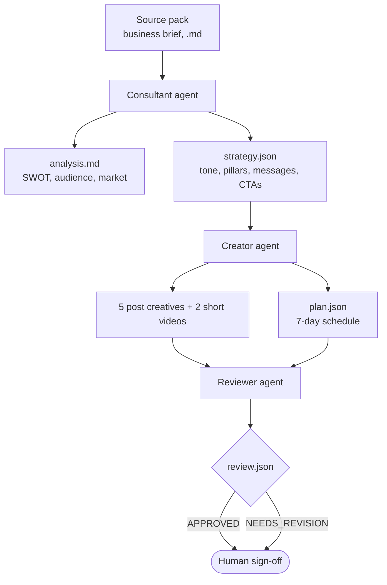

# BusinessIntelAI

**A multi-agent pipeline that turns a business brief into a full first week of marketing: an analysis, a content strategy, a 7-day plan, 5 post creatives and 2 narrated short videos, graded by a reviewer agent before a human signs off.**

---

## How it works



Agents hand off through files on disk, so every intermediate result can be inspected, and a single stage can be re-run on its own.

1. **Consultant:** reads the source pack and writes a business analysis (`analysis.md`), then turns it into a structured content strategy (`strategy.json`).
2. **Creator:** converts the strategy into a 7-day plan (`plan.json`) with exactly 5 posts and 2 videos, then produces each one:
   - **Posts:** a caption plus a generated image.
   - **Videos:** two render paths, picked by generation mode:
     - **Free:** 5 scene images, a Piper TTS voiceover, and MoviePy stitching with zoom transitions.
     - **Premium:** Wan 2.5 text-to-video (Fal AI) with a Piper voiceover overlaid.
3. **Reviewer:** grades the output in two passes:
   - **Programmatic checks:** all 5 posts exist, and each video folder has its images, `voiceover.wav` and an `.mp4`.
   - **LLM-as-judge:** reviews brand and strategy alignment, visual cohesion and consistency.

   The verdict, `APPROVED` or `NEEDS_REVISION`, is saved with feedback to `review.json`.

## Features

- **Automated quality gate:** deterministic file checks plus an LLM-as-judge review before anything reaches a human.
- **Two cost tiers:** a free mode on open tools, and a premium mode with cinematic text-to-video.
- **Observability:** every run logs an execution trace and per-step spend (`execution_trace.jsonl`, `spend_logs.jsonl`).
- **Two ways to run:** a Streamlit web UI to upload a brief and view or download results, or a one-command CLI pipeline.

## Quickstart

### Prerequisites
- Python 3.10+
- A Gemini API key ([get one here](https://aistudio.google.com/apikey))
- A Fal AI key, needed only for premium video mode
- The Piper voice model `en_US-lessac-medium.onnx` (a local TTS engine)

### Install
```bash
git clone https://github.com/huzefaarab/BusinessIntelAI.git
cd BusinessIntelAI
python -m venv .venv && source .venv/bin/activate
pip install -r requirements.txt
```

### Configure
Create a `.env` file in the project root:
```bash
GEMINI_API_KEY=your_gemini_key
FAL_KEY=your_fal_key        # premium mode only
```

### Run
```bash
# Web UI: upload a source pack and review the outputs in the browser
streamlit run app.py

# Or the full pipeline from the command line
python pipeline.py
```
The business name is read from the first line of the source pack, and all outputs go to `data/<business_name>/`.

## Outputs

```
data/<business_name>/
├── analysis/analysis.md          # SWOT, audience and market analysis
├── strategy/strategy.json        # tone, content pillars, key messages, CTAs
├── plan/plan.json                # 7-day schedule: 5 posts + 2 videos
├── content/
│   ├── posts/post_1.png … post_5.png
│   └── videos/video_1/, video_2/ # scene images (free mode), voiceover.wav, video_N.mp4
├── reviews/review.json           # APPROVED / NEEDS_REVISION + feedback
└── logs/
    ├── execution_trace.jsonl     # step-by-step run trace
    └── spend_logs.jsonl          # cost per step
```

## Project structure

```
BusinessIntelAI/
├── app.py            # Streamlit UI
├── pipeline.py       # Runs Consultant → Creator → Reviewer in sequence
├── agents/
│   ├── consultant/   # analysis + strategy (consultant.py, prompts.py)
│   ├── creator/      # plan, posts, videos (creator.py, prompts.py)
│   └── reviewer/     # file checks + LLM-as-judge review (reviewer.py, prompts.py)
├── models/  utils/  docs/  source_files/
└── requirements.txt
```

## Known limitations

- **Revision doesn't loop back:** a `NEEDS_REVISION` verdict is reported for a human to act on; the Creator isn't automatically re-run with the feedback.
- **The judge is the same model family as the creator:** an LLM grading its own family's output can be lenient, so the deterministic file checks are the stricter half of the review.
- **Image quality depends on the free image API:** posts use Pollinations AI, so output varies run to run.

## Tech stack
Python · Gemini API (`google-genai`) · Pollinations AI (images) · Fal AI Wan 2.5 (video) · Piper TTS · MoviePy · Streamlit

---

**Author:** Huzefa Arab · B.Tech ECE (AI & ML), MIT World Peace University